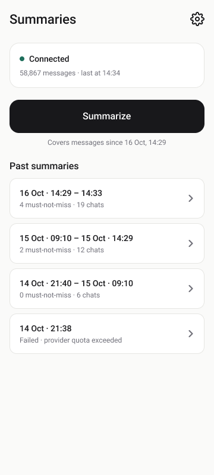
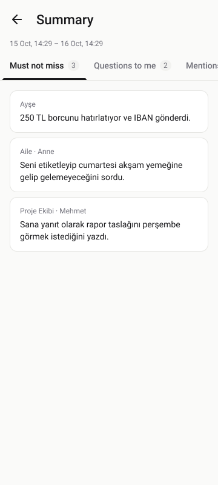
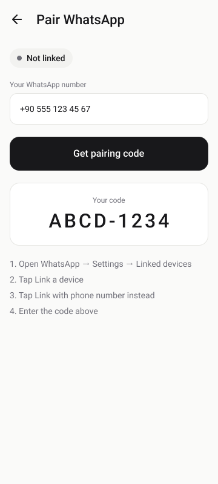
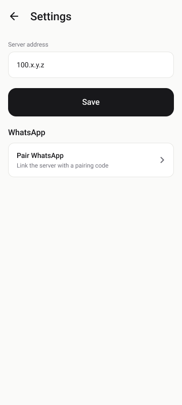

# WhatsApp Summarizer

A personal, self-hosted tool that reads your WhatsApp as a linked device and turns the flood of chats
into one short, structured summary on your phone: what you must not miss, questions waiting for you,
mentions, dates and plans, and a brief for every chat.

It is **strictly read-only**: it never sends messages, never sends read receipts, never marks chats as
read and never appears online. Your phone behaves as if it did not exist.

<p align="center">
  
  
  
  
</p>

## How it works

```
 WhatsApp on your phone
        │  linked device (multi-device protocol, read-only)
        ▼
 ┌──────────────── server/ (Node.js, runs 24/7) ────────────────┐
 │  Baileys ──► SQLite (every message, incl. archived & muted)   │
 │  POST /summaries ──► per-chat summaries ──► combined summary  │
 │                         │                                     │
 │                         ▼                                     │
 │        LLM provider: Anthropic · OpenAI · any OpenAI-         │
 │        compatible API (Gemini, OmniRoute, …)                  │
 └───────────────────────────────▲──────────────────────────────┘
                                 │ REST + bearer token (e.g. over Tailscale)
                        android/ app (Kotlin, Compose)
```

1. The **server** links to your WhatsApp account like WhatsApp Web, stores every incoming and outgoing
   message (text and captions only, media is never downloaded) and keeps running in the background.
2. When you tap **Summarize** in the **Android app**, the server takes all messages since the last
   summary, summarizes each chat separately (splitting very large chats into chunks), then writes one
   overview on top.
3. The result is strict JSON, validated with zod. Every flagged item must point at a real stored message
   id, or it is dropped, so the model cannot invent things.

## Features

- **Structured summaries** in sections: Must not miss · Questions to me · Mentions · Dates & plans ·
  Per chat · Overall. They're shown as swipeable tabs in the app.
- **Knows what is actually for you.** In group chats a message only counts as addressed to you if it
  tags you, replies to one of your messages, or contains your name (`OWNER_NAME`, Turkish suffixes
  included). This is enforced in code after the model runs, not just asked for in the prompt.
- **Any language**, Turkish by default (`SUMMARY_LANGUAGE`).
- **Swappable AI provider**: Anthropic or OpenAI out of the box; Gemini, OmniRoute and other
  OpenAI-compatible APIs through `OPENAI_BASE_URL`. A built-in rate limiter (`SUMMARY_MAX_RPM`) makes
  free tiers usable.
- **Pairing from the same phone**: link with an 8-character pairing code instead of scanning a QR.
- **Minimal Android app**: Material 3, follows the system light/dark theme, one setting (the server
  address).

## Repository layout

| Path | What it is |
|------|------------|
| [`server/`](server) | Node.js 20+ / TypeScript service: Baileys, SQLite (better-sqlite3), Fastify REST API, summary pipeline. See [server/README.md](server/README.md) for the full API. |
| [`android/`](android) | Kotlin + Jetpack Compose app (Material 3, Hilt, Retrofit, kotlinx.serialization, DataStore), minSdk 26. |
| [`docs/`](docs) | Screenshots of the app design. |

## Getting started

### 1. Run the server

You need an always-on Linux machine (a small VPS or home server) with Node.js 20+.

```bash
git clone https://github.com/yukentsii/whatsapp-summarizer.git
cd whatsapp-summarizer/server
cp .env.example .env          # then edit .env (see below)
npm ci
npm run build
npm start
```

To keep it running, use a process manager (e.g. `pm2 start dist/src/index.js --name whatsapp-summarizer --node-args="--env-file=.env"`)
or Docker (`docker compose up -d --build`, which keeps the database and WhatsApp login in `./data`).

The most important settings in `.env`:

| Variable | Purpose |
|----------|---------|
| `API_TOKEN` | Long random string that the app sends as a bearer token (`openssl rand -hex 32`). |
| `HOST` / `PORT` | Where the API listens. Use `127.0.0.1` behind an HTTPS reverse proxy, or the server's Tailscale IP to reach it only from your own devices. |
| `OWNER_NAME` | Your first name, so group messages that name you count as addressed to you. |
| `SUMMARY_PROVIDER` | `anthropic` or `openai` (the latter also covers OpenAI-compatible APIs). |
| `SUMMARY_MODEL` | Model id, e.g. `claude-opus-5-5`, or a Gemini / OmniRoute model id. |
| `ANTHROPIC_API_KEY` / `OPENAI_API_KEY` | API key for the chosen provider. Keys are only ever read from the environment. |
| `OPENAI_BASE_URL` | Optional, for OpenAI-compatible APIs, e.g. `https://generativelanguage.googleapis.com/v1beta/openai/` for Gemini or `http://<host>:20128/v1` for OmniRoute. |
| `SUMMARY_LANGUAGE` | Output language, default `Turkish`. |
| `SUMMARY_MAX_RPM` | Optional cap on model requests per minute, e.g. `5` for a free tier. |
| `TZ` | Time zone used when showing message times to the model. |

### 2. Link WhatsApp

On first start the server waits for pairing. Either:

- **Pairing code** (works from the same phone): open the app's Pair WhatsApp screen, enter your number
  and type the 8-character code under *WhatsApp → Linked devices → Link a device → Link with phone
  number instead*; or
- **QR code**: scan the QR the server prints in its logs from another screen.

The login is saved in `data/auth`, so restarts don't need re-pairing. History from your phone (including
archived and muted chats) is imported automatically after linking.

### 3. Build the Android app

Requires the Android SDK and JDK 17+.

Create `android/local.properties` (it is git-ignored):

```properties
sdk.dir=/path/to/Android/Sdk
# The server's API_TOKEN, compiled into your build so you never type it on the phone.
api.token=<API_TOKEN from server/.env>
# Optional: hosts the app may reach over plain HTTP, e.g. the server's Tailscale IP.
cleartext.hosts=100.x.y.z
```

Then:

```bash
cd android
./gradlew assembleDebug
```

Install `app/build/outputs/apk/debug/app-debug.apk`, open **Settings** and enter the server address
(e.g. `100.x.y.z`; `http://` and port `3000` are added automatically, or enter a full `https://` URL).

### Reaching the server from your phone

The simplest private setup is [Tailscale](https://tailscale.com): set `HOST` to the server's Tailscale IP,
add that IP to `cleartext.hosts`, and install Tailscale on your phone. Traffic is encrypted by WireGuard
and the API is unreachable from the internet. Alternatively, put the server behind an HTTPS reverse
proxy and enter its `https://` URL in the app.

## Read-only by design

- The device never announces itself as online (`markOnlineOnConnect: false`), so delivery receipts go out
  as "inactive" and your phone keeps notifying you as usual.
- Read receipts are never sent and chats are never marked as read.
- Retry requests from other devices never cause a resend.
- `sendMessage`, `readMessages`, `sendPresenceUpdate`, `chatModify` and similar socket methods are replaced
  with stubs that throw, and a unit test checks this.
- Message contents and API keys are never logged at info level.

## Development

```bash
cd server
npm test      # builds, then runs the unit tests (parsing, storage, API, summary pipeline with a mocked model)
```

The summary tests run a deterministic mock provider over a fixture of 50 messages in 3 chats. They check
that every flagged item references a real message id, that invented ids and messages not addressed to
the owner are dropped, and that chunking, merging and retry-on-invalid-JSON work.

## Disclaimer

This is a personal project, not affiliated with WhatsApp or Meta. It uses
[Baileys](https://github.com/WhiskeySockets/Baileys), an unofficial WhatsApp Web client. Using unofficial
clients may violate WhatsApp's Terms of Service and could get an account restricted; use it only with
your own account and at your own risk. The same applies to any third-party AI gateway you route
requests through. Your messages are sent to the AI provider you configure, so choose one you trust.

## License

[MIT](LICENSE)
